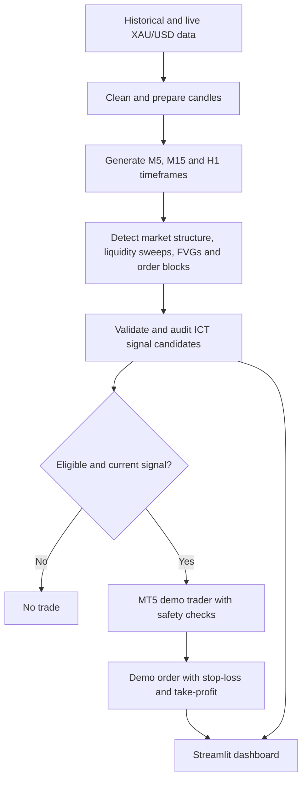

# SmartTrade AI
### Python-Based Gold Market Intelligence & MT5 Demo Trading

**SmartTrade AI** is a personal Python engineering project for analyzing XAU/USD (gold), identifying rule-based trading opportunities inspired by Inner Circle Trader (ICT) concepts, and monitoring trades through an interactive Streamlit dashboard.

**Project status:** Working prototype / ongoing development. A Python-to-MetaTrader 5 demo SELL order has been executed successfully. Continuous unattended trading and cloud deployment are not presented as production-ready.

## The Problem

Analyzing market structure, liquidity, fair value gaps, and order blocks manually across multiple timeframes can be time-consuming. Trading decisions also need consistent timing, validation, and risk controls.

## The Solution

SmartTrade AI brings market-data preparation, ICT-style pattern detection, signal evaluation, and MT5 demo integration into a modular Python workflow. A Streamlit interface presents candlesticks, candidate signals, and demo position information.

## System Workflow

## Features Implemented or Prototyped

- **Market-data pipeline:** Cleans XAU/USD one-minute data and resamples it into M5, M15, and H1 candles.
- **ICT-style detection:** Separate Python modules detect fair value gaps, swing-based market structure, liquidity sweeps, and order blocks.
- **Signal validation:** Audits candidate setups and filters entries using eligibility and timing rules.
- **MT5 demo integration:** Demonstrated an automated 0.01-lot XAU/USD SELL order with stop-loss and take-profit on a demo account.
- **Interactive dashboard:** Streamlit and Plotly display gold candlesticks, current analysis, signal history, and MT5 open positions with profit/loss when locally connected.
- **Trading-power control:** A dashboard switch writes an ON/OFF setting read by a separate Python monitoring engine.
- **Monitoring prototype:** A long-running Python process periodically launches analysis and the demo-trader module. Fully automated new-order execution still requires additional validation and safeguards.

## Technology Stack

| Layer | Technologies |
| --- | --- |
| Programming | Python |
| Data analysis | Pandas, NumPy |
| Dashboard | Streamlit, Plotly |
| Trading integration | MetaTrader 5 Python API, MT5 demo account |
| Development | Visual Studio Code, Git |
| Data formats | CSV, Parquet |

## Architecture and Engineering Decisions

The project separates market-data preparation, strategy detectors, validation, demo order submission, and presentation into independent modules. This makes each stage easier to inspect and test.

Signal freshness is important: a historical pattern should not automatically become a new trade. The system checks for current eligible setups, and the trading prototype includes checks around existing positions. These safeguards remain under development and should not be interpreted as a guarantee against duplicate orders or losses.

The dashboard runs locally with MT5 on Windows. A GitHub README is a project showcase, **not** a deployed trading service.

## Demonstrated Milestone

A Python script successfully submitted a **demo** XAU/USD SELL trade through MetaTrader 5, using a 0.01-lot volume with configured stop-loss and take-profit. The open position and floating profit/loss were subsequently visible in the local Streamlit dashboard.

This is an integration milestone, **not evidence of a profitable or validated trading strategy**.

## Roadmap

- [x] Prepare and resample historical gold data
- [x] Implement initial ICT-style pattern detectors
- [x] Build signal auditing and analysis reports
- [x] Build the Streamlit market and positions dashboard
- [x] Demonstrate a Python-submitted MT5 demo order
- [ ] Complete and test unattended execution safeguards
- [ ] Add structured logs, exception recovery, and order reconciliation
- [ ] Backtest with realistic spread, slippage, and transaction costs
- [ ] Evaluate forward-test results and strategy robustness
- [ ] Design secure remote monitoring or hosting, if needed

## Portfolio Scope and Security

This repository is intended to document the project architecture, development workflow, and engineering progress. It does not need to publish trading-account credentials, local configuration, broker identifiers, private datasets, or the executable trading engine. Screenshots should be reviewed to remove account numbers and other sensitive information before publication.

## Disclaimer

SmartTrade AI is an educational and experimental software project. It is not financial advice, does not guarantee profitability, and is not presented as a production-ready autonomous trading system. All described execution tests used a demo account.
